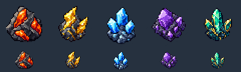

# Legendary Mining Drop artwork

These original ore icons were generated with the built-in image_gen tool with a transparent background. Inventory PNGs are exported at 48×48 using Godot nearest-neighbor resizing, preserving alpha. The existing ItemIconResolver finds each uppercase, hyphen-free filename automatically.

| Tier | Item ID | Name | Color | Sale value | Planned chance per rock |
| --- | --- | --- | --- | ---: | ---: |
| 1 | emberite-ore | Emberite Ore | Orange/red | 10,000 | 1% |
| 2 | voltite-ore | Voltite Ore | Gold/yellow | 25,000 | 0.75% |
| 3 | glacite-ore | Glacite Ore | Cyan/blue | 50,000 | 0.5% |
| 4 | astralite-ore | Astralite Ore | Violet | 100,000 | 0.35% |
| 5 | aetherium-ore | Aetherium Ore | Turquoise/gold | 250,000 | 0.25% |

Canonical item definitions are in the paired backend's pokemon-data/data/items/legendary-mining-ores.json. This asset task defines names, tiers, sale values and icons. Rock-specific loot, bad-luck protection and the museum buyer are not implemented yet; the planned chances above are design targets, not active drop rates.

## Generation prompts

### emberite-ore

Source generation ID: exec-f4404c58-babb-43bf-9e63-eb77251d10fe.png

Use case: stylized-concept. Asset type: transparent pixel-art inventory item icon for a classic handheld monster-catching RPG. Primary request: one original emberite-ore mineral ore item. Subject: A squat angular charcoal-gray rock nugget with three bright burnt-orange and ember-red crystal veins and a tiny warm cream highlight. Compact chunky silhouette. Style: strict hand-placed low-resolution pixel art, exactly a 32 by 32 logical pixel grid enlarged using nearest-neighbor, a 1-pixel dark outline, flat palette of roughly 12 colors, no anti-aliasing. Composition: single centered isolated ore occupying 24 by 24 logical pixels with four logical pixels transparent padding on all sides; viewed at three-quarter angle. Lighting from upper left. Transparent background with real alpha. No text, labels, border, ground, cast shadow, particle effects, glow haze, gradients, multiple icons, interface or watermark. Keep every visible mark aligned to the pixel grid. Deliver a square PNG, crisp at inventory size.

### voltite-ore

Source generation ID: exec-5f5b1c80-f08d-4dc3-9992-c756189ab38b.png

Use case: stylized-concept. Asset type: transparent pixel-art inventory item icon for a classic handheld monster-catching RPG. Primary request: one original voltite-ore mineral ore item. Subject: An angular dark slate-gray rock nugget with two jagged golden-yellow lightning-like crystal spikes, amber facets and tiny pale yellow highlights. Asymmetric zigzag silhouette. Style: strict hand-placed low-resolution pixel art, exactly a 32 by 32 logical pixel grid enlarged using nearest-neighbor, a 1-pixel dark outline, flat palette of roughly 12 colors, no anti-aliasing. Composition: single centered isolated ore occupying 24 by 24 logical pixels with four logical pixels transparent padding on all sides; viewed at three-quarter angle. Lighting from upper left. Transparent background with real alpha. No text, labels, border, ground, cast shadow, particle effects, glow haze, gradients, multiple icons, interface or watermark. Keep every visible mark aligned to the pixel grid. Deliver a square PNG, crisp at inventory size.

### glacite-ore

Source generation ID: exec-e00826bb-b506-442b-9c1c-7c2ff8b33bc0.png

Use case: stylized-concept. Asset type: transparent pixel-art inventory item icon for a classic handheld monster-catching RPG. Primary request: one original glacite-ore mineral ore item. Subject: A dark blue-gray rock nugget holding three icy cyan and pale blue pointed crystal prisms, deep cobalt facets and tiny white highlights. Upright triangular cluster silhouette. Style: strict hand-placed low-resolution pixel art, exactly a 32 by 32 logical pixel grid enlarged using nearest-neighbor, a 1-pixel dark outline, flat palette of roughly 12 colors, no anti-aliasing. Composition: single centered isolated ore occupying 24 by 24 logical pixels with four logical pixels transparent padding on all sides; viewed at three-quarter angle. Lighting from upper left. Transparent background with real alpha. No text, labels, border, ground, cast shadow, particle effects, glow haze, gradients, multiple icons, interface or watermark. Keep every visible mark aligned to the pixel grid. Deliver a square PNG, crisp at inventory size.

### astralite-ore

Source generation ID: exec-3dc5a397-d762-493f-8cf4-2fbbe168fca2.png

Use case: stylized-concept. Asset type: transparent pixel-art inventory item icon for a classic handheld monster-catching RPG. Primary request: one original astralite-ore mineral ore item. Subject: A dark charcoal-purple rock nugget with a broad amethyst-violet faceted crystal, smaller lilac shards, indigo shadows and tiny pale lavender highlights. Broad diamond-like silhouette. Style: strict hand-placed low-resolution pixel art, exactly a 32 by 32 logical pixel grid enlarged using nearest-neighbor, a 1-pixel dark outline, flat palette of roughly 12 colors, no anti-aliasing. Composition: single centered isolated ore occupying 24 by 24 logical pixels with four logical pixels transparent padding on all sides; viewed at three-quarter angle. Lighting from upper left. Transparent background with real alpha. No text, labels, border, ground, cast shadow, particle effects, glow haze, gradients, multiple icons, interface or watermark. Keep every visible mark aligned to the pixel grid. Deliver a square PNG, crisp at inventory size.

### aetherium-ore

Source generation ID: exec-d622a387-f845-4e30-b3c2-5a48c2d8b8c2.png

Use case: stylized-concept. Asset type: transparent pixel-art inventory item icon for a classic handheld monster-catching RPG. Primary request: one original aetherium-ore mineral ore item. Subject: A dark midnight-teal rock nugget holding a tall luminous turquoise-green crystal core between two smaller gold-edged crystal shards, teal shadows and tiny mint-white highlights. Regal three-pronged silhouette. Style: strict hand-placed low-resolution pixel art, exactly a 32 by 32 logical pixel grid enlarged using nearest-neighbor, a 1-pixel dark outline, flat palette of roughly 12 colors, no anti-aliasing. Composition: single centered isolated ore occupying 24 by 24 logical pixels with four logical pixels transparent padding on all sides; viewed at three-quarter angle. Lighting from upper left. Transparent background with real alpha. No text, labels, border, ground, cast shadow, particle effects, glow haze, gradients, multiple icons, interface or watermark. Keep every visible mark aligned to the pixel grid. Deliver a square PNG, crisp at inventory size.
