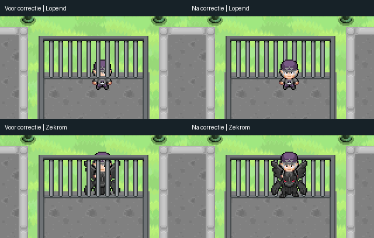
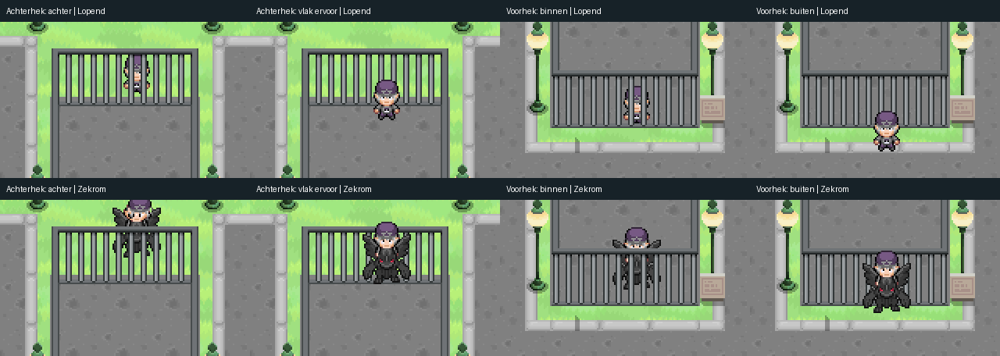

# Viridian jail depth correction — 23 October 2026

The rear jail wall was split between `TreeBottom` and `StructureTop`. Its upper
edge was connected to the front wall, so it inherited the front wall's depth,
while the lower middle bars always drew below actors. Large mounts exposed both
problems. Actor ground-depth and mount/rider ordering remain unchanged.

The artist source now contains complete `JailBack`, `JailFront`, and `JailPosts`
assemblies with `pao_depth_sort=groups`. `JailSides` uses `pao_depth_sort=rows` so
its vertical rails do not join the two wall boundaries. The visual importer
retains this metadata; world normalization uses it without reserved layer names.
Existing layers without the hint retain their previous sorting behavior.

The rear wall sorts at world Y 1228 and the front wall/posts at Y 1440 when the
map is at the origin. `JailBack` carries `pao_depth_offset_y=-20`: its corner
continuations extend 20 pixels below the horizontal bar's ground contact. Side rows sort at their individual bottom edges. These
are visual anchors, not prescribed blocked/open tiles. No gameplay scene,
Collision layer, movement, mount asset, backend, or release configuration changed.

## Source and generated output

Edited source:
`/home/adinho/Documents/tiled_pokeaether/kanto/artist/exterior/towns/Viridian City.tmx`

Backup:
`/home/adinho/Documents/tiled_pokeaether/kanto/artist/backups/viridian-jail-depth-20261023/Viridian City.tmx`

The artist directory is not a Git repository. The exact source edit is retained
in [viridian-jail-depth-source.patch](viridian-jail-depth-source.patch).

- Before SHA-256: `75173e8f3a989ce4a33a5fd5b52037bd791bad3ad05a2e88c25b0d02fa07332a`
- After SHA-256: `54f62318bc298f98622e712ceeb7e38c36794c6dd26b50cc7dd08a18cb0b9e77`

52 visual tiles moved between layers; none were added, deleted, or repositioned.
The full-map native Tiled renders before and after have identical pixels.

A full standard reimport was tested and rejected: existing Godot tree animations
are not present in the artist TMX, so rebuilding the atlas removed those native
animations. The final generated scene instead uses
`tools/update_viridian_jail_layers.gd` to apply precisely the same layer split to
the existing imported tile identities. All original atlas and TileSet files are
unchanged. The tool migrates the pre-split visual or updates an existing split with its
rear ground-contact offset. It is a no-op once both are present. Future full imports still need to preserve the
project's native animation additions; this task does not rebuild that pipeline.

From `game/`, after applying the paired TMX edit:

```sh
ops/worktrees/slot-env slot-b -- godot --headless --path .worktrees/slot-b/frontend --script res://tools/update_viridian_jail_layers.gd
```

## Ground-contact follow-up

The initial 192-case test incorrectly labelled Y=1232 as behind the rear wall.
The horizontal bar actually ends at local Y=76 (world Y=1228); the corner rails
continue to local Y=96. Consequently, a character on the nearest southern tile
was still covered by the full wall. The initial test's passing result did not
validate that boundary, and the user's screenshots exposed the incorrect label.

The corrected test labels Y=1200 as behind, Y=1232 as immediately in front, and
also retains the farther front sample at Y=1264. Before the correction, exactly
48 of 240 native render cases fail, all at Y=1232. With the authored -20px offset,
all 240 pass. The generic offset is transformed with the layer, with synthetic
checks for translation and scale. It changes sorting only; every tile, texture,
animation and collision layer is preserved.

The pre-offset source backup is in
`artist/backups/viridian-jail-boundary-20261023/Viridian City.tmx`.
The native Tiled render is unchanged by this metadata-only correction.



## Verification

Passed:

- Artist `mapping/tools/audit_maps.py`: finite CSV layout, GIDs, dependencies,
  animation references, and all 11 layers.
- `viridian_visual_jail_check`: independent front/rear boundaries, row sorting,
  complete posts, preserved tile identity, translated synthetic fixture,
  repeated normalization, and legacy fallback.
- `tmx_visual_importer_check`: both depth hints survive actual TMX import.
- `mount_world_depth_check`, `object_lower_depth_check`, `tree_lower_depth_check`,
  `viridian_forest_depth_order_check`, and `map_depth_lookup_check`.
- `tools/check_viridian_jail_repartition.gd -- <previous frontend checkout>`:
  all 9,917 visual tile occurrences retain their pixels and animation timelines;
  1,216 unique frames per version compared, with compact/lossless atlas checks.
- Native `viridian_jail_render_check` (OpenGL compatibility, real display):
  240 comparisons covering local/remote actors, walking/Zekrom/Rayquaza,
  four directions, walk frames 0 and 2, both sides of both walls, and the
  nearest tile in front of the rear wall. Hover is
  sampled for mounts. Each wall crop matches independently forced correct
  ordering and differs from deliberately reversed ordering, proving visible
  actor/wall overlap in every case. The test disables actor cameras and pauses
  sprite processing while comparing each pose; unrelated scenery animation is
  excluded by the wall crop.



Tests ran through `slot-env slot-b`; logs and full native screenshots remain in
that slot's `.runtime` directory. Existing battle texture UID warnings fall back
to their valid text paths. No full release gate, multiplayer server playtest,
push, deployment, or main-branch merge was performed.
